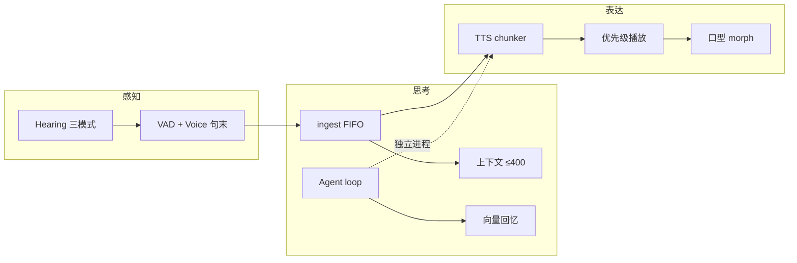

# 端到端闭环

> 算法主轴：一次「说完 → 想完 → 说回去」里，各域决策按什么顺序咬合。
> 实现入口仍在功能域；本篇只画**决策顺序**与交叉点。

## 产品主轴（Stage）

```text
麦音频
  → [Hearing 模式] always-on / PTT / wake-word
  → [切段] Silero VAD + Voice 句末（可选 end-judge）
  → STT（hearing.createTranscriber）
  → 草稿 / auto-send（可选 rephrase）
  → [编排] ingest → FIFO 队列 → compose → LLM stream
  → [播控] SpeechPipeline：TTS chunker → 优先级播放
  → [口型] volume × vowel morph → Live2D/VRM
```

| 步 | 算法专题 | 功能域 |
|----|----------|--------|
| 模式 / 切段 / 句末 | [切段与播控](./切段与播控.md) | [听力转写](../语音交互/听力转写.md) |
| 编排 | [编排与上下文](./编排与上下文.md) | [聊天编排](../角色对话/聊天编排.md) |
| 播控 | [切段与播控](./切段与播控.md) | [语音合成](../语音交互/语音合成.md) |
| 口型 | [口型驱动](./口型驱动.md) | [Live2D与VRM](../舞台呈现/Live2D与VRM.md) |

Web 文本输入可跳过听入链，直接从 `ingest` 进入编排；TTS/口型仍挂在 Stage / Voice 钩子上。见 [聊天与语音路径](../多端应用/网页端/聊天与语音路径.md)。

## 主成功路径（印象）

读功能域前，先按用户能感知的顺序记一遍：

1. 模式允许开麦（或用户打字）→ 一句输入定稿（听入则经 VAD / 句末 / 可选改写）
2. 文本进入 `ingest` → FIFO 串行 → 用户气泡先落 → 助手流式变长 → IDB 持久化
3. 若本回合 `speaks` 且未静音 → Stage 开朗读 → chunk 播放 → 口型跟音量 / 元音

文字发送从步骤 2 起；听入从步骤 1 起。Channel 桥也汇入步骤 2 的同一队列。

## 常见中断

| 中断 | 主轴停在哪 | 用户侧大致结果 |
|------|------------|----------------|
| 模式 / 唤醒不满足 | 听入未开始 | 说话不进草稿 |
| 取消听入或丢弃草稿 | 未进 `ingest` | 无新用户消息 |
| 排队发送被 cancel / generation 变了 | 编排未开跑或出队 reject | 旧回复不冒泡 |
| 取消正在流式的一轮 | 编排中途 abort | 助手气泡停更；TTS 收束 |
| `speech-noop` / 静音 / `speaks: false` | 思考完成，表达跳过或无声 | 有字无声（或后台无朗读） |
| 独立 Agent 线 | **不**走本 FIFO | 另见旁路 B；勿用 Stage 队列解释 TG 慢回 |

阈值与作废细则进下方专题；包路径进功能域。

## 旁路 A：Channel 机器人

```text
Discord 等外部消息
  → Channel 事件
  → context-bridge（input:text）
  → 同一套 ingest / 编排 /（可选）TTS
  → output:gen-ai:chat:* 回桥
```

**不**另起 Agent loop；大脑仍是 Stage 聊天编排。
细节：[Discord竖切](../通道机器人/Discord竖切.md) · [Channel事件速查](../通道机器人/Channel事件速查.md)。

## 旁路 B：独立 Agent

```text
平台消息
  → 未读池（截断）
  → [调度] arrival 立即跑 / 周期 tick
  → imagineAnAction（JSON Action）
  → read_unread →（Telegram）[记忆检索]
  → send_message / sleep / break …
```

与 Stage 主轴**并行存在**：独立进程自带 LLM loop，不经 `ingest`。
细节：[Agent调度](./Agent调度.md) · [记忆检索](./记忆检索.md) · [对照总览](../独立Agent/对照总览.md)。

## 一张对照图



| 问题类型 | 先看 |
|----------|------|
| 话说完很久才进输入框 / 聊天 | Hearing 模式 · VAD · Voice 句末静音 |
| 连发消息顺序乱或旧回复冒出来 | 编排 FIFO · generation |
| Bot 不回或回太慢 | Agent 调度 · 未读截断 |
| 回忆文不对题 | 记忆检索分数与 Top-K |
| 嘴张合怪 / 抖 | 口型公式与平滑窗 |

## 阅读顺序

1. 本篇建立主轴
2. 按上表进专题
3. 回功能域学习路径跟源码
